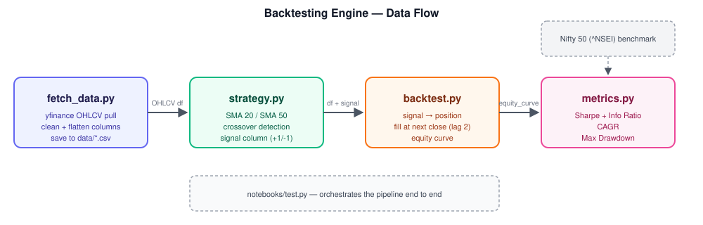
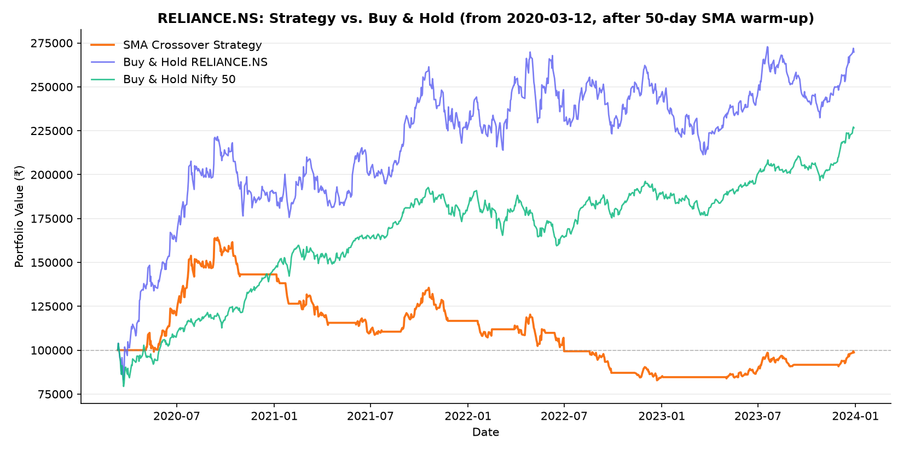

# Backtesting Engine

A Python backtesting engine for a moving-average crossover strategy on Indian equities, built from scratch i.e. data pipeline, signal generation, position simulation, and performance analytics, benchmarked against the Nifty 50.

This project isn't just "does it run". It's built around getting the mechanics *correct*: no lookahead bias, adjusted prices, and honest performance reporting including where the strategy fails.



## Project Structure

```
backtesting-engine/
├── data/                   # cached OHLCV pulls (gitignored)
├── docs/                   # diagrams / images used in this README
├── notebooks/
│   └── test.py             # orchestrates the full pipeline end-to-end
├── tests/
│   └── test_backtest_timing.py # checks signal-to-return timing
├── src/
│   ├── fetch_data.py       # yfinance data fetching + cleaning
│   ├── strategy.py         # SMA crossover signal generation
│   ├── backtest.py         # signal → position → equity curve
│   └── metrics.py          # Sharpe, Information Ratio, CAGR, max drawdown
├── requirements.txt
└── README.md
```

## Pipeline

1. **`fetch_data.py`** : pulls OHLCV data via `yfinance`, flattens the MultiIndex column structure, and saves each pull to `data/*.csv`. It currently downloads again on each run; reading from the saved files as a cache is not implemented yet. Uses `Adj Close` for signals and returns.
2. **`strategy.py`** : computes a 20-day and 50-day SMA and flags the exact day the short SMA crosses the long SMA (`signal = 1` on a golden cross, `-1` on a death cross), not just "which SMA is currently on top."
3. **`backtest.py`** : converts sparse crossover signals into a continuous long-or-flat position. A signal is known only after that day's close. The current simulation assumes the order fills at the following session's close; it starts earning close-to-close returns after that assumed fill. Returns compound into an equity curve via `.cumprod()`.
4. **`metrics.py`** : computes annualised Sharpe ratio using a fixed risk-free rate, Information Ratio against benchmark returns, CAGR, and maximum drawdown.

## Key Design Decisions

- **Signal timing.** Crossover signals use closing prices and are known only after the close. The simulator assumes execution at the next session's close and delays credited returns until after that fill. `tests/test_backtest_timing.py` uses large synthetic price jumps around buy/sell signals to check that the strategy does not earn a return before its assumed fill. This is a simplified daily-bar execution convention; it does not model intraday fills.
- **Adjusted close, not raw close.** Raw `Close` shows fake price cliffs around stock splits/dividends, which would generate false signals. `Adj Close` is used for all signal and return calculations.
- **Distinct risk metrics.** Sharpe compares strategy returns with a risk-free rate. Information Ratio compares strategy returns with Nifty 50 (`^NSEI`) returns. They answer different questions and are reported separately.

## Previous Results (Preliminary; Re-run Required)

The values below are retained from a previous run of the backtester, before the execution-timing correction described above. They do not include transaction costs or slippage and should not be treated as validated results for the current code. The source and settings for the two rows labeled `(a)` and `(b)` were not recorded, so those figures are not reproducible from the README alone. Re-run all windows with the current timing convention and record the exact metric definitions and assumptions before drawing conclusions.

The prior run reported these figures for RELIANCE.NS:

| Window | Strategy Return | Nifty 50 Return | Sharpe | Notes |
|---|---|---|---|---|
| 2020–2024 | 13.45% | 78.38% | -0.74 | Includes COVID crash + choppy 2021-22 |
| 2022–2024 | 0.38% | 23.29% | -0.98 | Sideways/choppy, worst regime for this strategy |
| 2018–2022 (a) | 73.79% | 66.19% | +0.06 | Outperformed, but Sharpe barely positive |
| 2018–2022 (b) | 40.88% | 16.53% | +0.65 | Clear outperformance, strongest Sharpe |



**Max drawdown (2020–2024 window): -41.78%** vs. **-21.68%** for buy-and-hold RELIANCE.NS.

The previous analysis attributed the reported drawdown to repeated whipsaws during sideways consolidation. That explanation, like the figures above, needs to be rechecked after rerunning the backtest with corrected timing and transaction costs.

**Working hypothesis:** trend-following strategies can enter trends late and lose through repeated whipsaws in sideways markets. Whether that explains this strategy's current results remains to be verified.

## Setup

```bash
git clone https://github.com/AnanshSrivastava/backtesting-engine.git
cd backtesting-engine

python -m venv venv
source venv/Scripts/activate      # Windows Git Bash
# .\venv\Scripts\Activate.ps1     # Windows PowerShell

pip install -r requirements.txt
```

## Usage

```bash
python notebooks/test.py
```

This fetches data for the configured ticker and benchmark, runs the crossover strategy, simulates the backtest, and prints CAGR, Sharpe Ratio, Information Ratio, drawdown, and total returns. Data is currently downloaded on each run.

## Tests

The timing tests use synthetic prices so no network data is needed. Install `pytest` in the environment, then run:

```bash
python -m pytest
```

## Limitations & Next Steps

- Transaction costs and slippage are not modeled yet; current results are pre-cost.
- Single-asset, long-only. No portfolio-level allocation across multiple tickers.
- Considering a second-indicator confirmation filter (e.g. RSI) to reduce whipsaw frequency in choppy regimes — not yet implemented, and not guaranteed to help, since whipsaw risk is a fairly fundamental property of trend-following in sideways markets.
- Risk-free rate is currently a fixed approximation rather than actual historical G-Sec yields.

## Tech

Python, pandas, NumPy, yfinance, matplotlib
